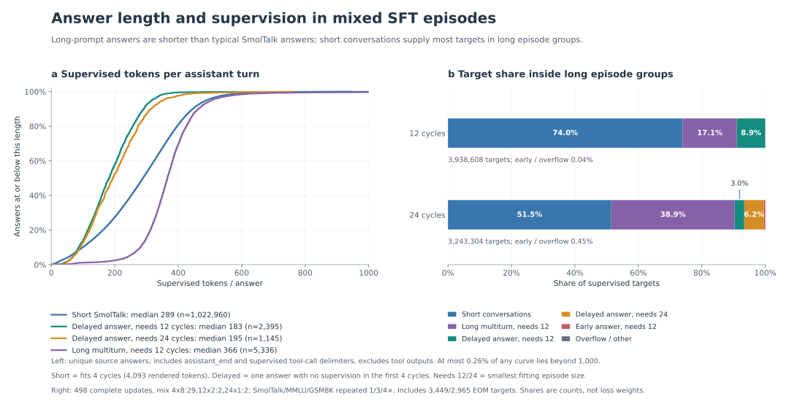

# RLM SFT loss weighting: design discussion

Recorded on November 16, 2026.
Status: both loss-weighting methods and mixed-episode training are implemented, with a completed data investigation.
The trainer requires an explicit choice through `--loss-weighting {microbatch,group-token}` and a required `--episode-mix`.
No model-quality winner has been selected; equal-microbatch averaging remains the recommended first comparison baseline.

## Question and current position

How should one optimizer update combine assistant-only losses from microbatches with different episode lengths and different numbers of supervised targets?
The aim is to preserve ordinary chat quality while giving useful training emphasis to answers that follow long inputs.
The [mixed-episode packing discussion](RLM_LONG_DOCUMENTS.md) establishes the data layout; this document considers the loss weighting applied to those batches.

The `microbatch` method averages microbatch mean losses equally.
The `group-token` method uses explicit weights for each episode-length group and normalizes by the total number of supervised targets within each group.
Its initial suggested weights were 88% for four cycles, 6% for twelve cycles, and 6% for twenty-four cycles.
Those weights approximately preserve the example mix's equal-microbatch allocation between groups, but they do not preserve how individual examples are weighted within a group.

The initial preference for the proposal was based on making the objective independent of microbatch partitioning.
The investigation subsequently showed a substantial tradeoff: for the measured packing, the proposal reduces the combined objective coefficient of delayed answers from 2.79% to 1.98%, a relative reduction of about 29%.
Short filler conversations and long multi-turn chats account for most supervised targets in the longer episode groups.
Unusually long individual answers are not the main explanation.

The revised recommendation is to retain equal-microbatch averaging as the comparison baseline and evaluate the proposed normalization before choosing a replacement.
Neither objective has been shown to produce better model quality in this comparison.

## Terms and example mix

A conversation contains user and assistant turns.
An episode is one packed loader row and may contain several conversations.
A microbatch contains one or more episodes of the same cycle count.
An optimizer update accumulates several microbatches before applying the optimizer.
An episode-length group contains all microbatches of one cycle count within that update.

For microbatch $j$, let $S_j$ be the sum of supervised losses and $N_j$ the number of supervised prediction targets.
Let $A$ be the number of accumulated microbatches and $G_c$ the set of microbatches with $c$ cycles.
All denominators below count supervised targets, not all input positions.

In the recurrent trainer, these targets include assistant text and eligible EOM readouts.
The rendering mask includes the assistant-end token and Python-call delimiters, but excludes user text, padding, assistant-start tokens, and Python tool outputs.
An internal chunk boundary inside an assistant answer contributes both the preceding text prediction and the next cycle's EOM prediction of that token.
These are two supervised predictions and both enter $S_j$ and $N_j$.
See [`render_conversation`](../../nanochat/tokenizer.py) and [`sft_episode_loss` / `eom_supervision`](../../nanochat/rlm_sft.py).

The discussion uses `4x8:29,12x2:2,24x1:2`:

| Cycles per episode | Episodes per microbatch | Microbatches per update | Chunks per update | Equal-microbatch group coefficient |
| ---: | ---: | ---: | ---: | ---: |
| 4 | 8 | 29 | 928 | 29/33 = 87.88% |
| 12 | 2 | 2 | 48 | 2/33 = 6.06% |
| 24 | 1 | 2 | 48 | 2/33 = 6.06% |
| Total | | 33 | 1,024 | 100% |

With `text_length = 1023`, this is 1,047,552 text positions per update on one worker.
The 6.06% coefficient of a long episode group is shared by every supervised prediction in that group, including shorter conversations packed into its episodes.
It is not reserved for answers belonging to conversations that require that episode length.
The mixed-schedule coefficients below were calculated from a packing replay using the two reductions; they are not measurements from a completed mixed-episode training run.

## Microbatch method: average microbatch means

With `--loss-weighting microbatch`, the recurrent SFT update in [`nanochat/rlm_sft.py`](../../nanochat/rlm_sft.py) backpropagates:

$$
L_{\mathrm{micro}} = \frac{1}{A}\sum_{j=1}^{A}\frac{S_j}{N_j}.
$$

Each microbatch gets the same coefficient, regardless of its supervised-target count.
Within microbatch $j$, each supervised prediction has coefficient $1/(A N_j)$.
Consequently, a target in a sparsely supervised microbatch receives more weight than a target in a densely supervised microbatch.
This is equal weighting of microbatch means, not equal weighting of conversations, episodes, or answers.

Before mixed-episode integration, the imported trainer's logged training loss used a different aggregation:

$$
L_{\mathrm{logged}} = \frac{\sum_j S_j}{\sum_j N_j}.
$$

That historical `loss` field reported the global target-weighted mean across the update.
The two aggregations agree when all microbatches have the same supervised-target count; they can also coincide accidentally for particular losses.
Their objectives are not generally equivalent when counts differ.
The implemented trainer now logs the actual optimized objective as `loss` and the global target-weighted mean separately as `token_loss`.
Recurrent validation continues to use total supervised loss divided by total supervised-target count under either training objective.

### Why the original code uses this pattern

The original NanoChat loop in [`scripts/chat_sft.py`](../../scripts/chat_sft.py) computes a mean loss for each microbatch, divides it by the accumulation count, and immediately backpropagates.
The recurrent trainer's `microbatch` mode follows that pattern while adding recurrent memory and eligible EOM supervision.
The base model's mean reduction is defined in [`nanochat/gpt.py`](../../nanochat/gpt.py).

Simplicity and reuse are plausible reasons for the choice, but the code does not establish the author's intent.
Equal-microbatch averaging is equivalent to a global token mean when every microbatch contains the same number of supervised targets, as in a fully supervised fixed-size batch with no ignored targets.
Assistant-only SFT breaks that assumption: equal input lengths can have different amounts of user text, assistant text, tool output, and padding.
The original chat trainer also logs a smoothed last-microbatch loss, whereas the imported recurrent trainer historically reported the target-weighted update aggregate above.

## Group-token method: explicit group weights and token normalization

For each episode-length group, define:

$$
L_c = \frac{\sum_{j\in G_c} S_j}{\sum_{j\in G_c} N_j}.
$$

With `--loss-weighting group-token`, the objective is:

$$
L_{\mathrm{group}} = \sum_c \alpha_c L_c,
\qquad
\alpha_c \geq 0,
\qquad
\sum_c \alpha_c = 1.
$$

The suggested starting point was:

$$
L_{\mathrm{group}} = 0.88 L_4 + 0.06 L_{12} + 0.06 L_{24}.
$$

These example weights are a proposal, not an empirically determined optimum or a trainer default.
They approximate the 29/33, 2/33, and 2/33 coefficients of the example mix.
An exact comparison can keep those fractions and change only the normalization within each group.
The CLI requires explicit `--group-loss-weights`, for example `4:0.88,12:0.06,24:0.06`.

The main rationale is to separate desired training emphasis from the microbatch sizes used to fit GPU memory.
For the same examples, same episode assignments, and fixed group weights, repartitioning a group into different microbatches preserves the mathematical objective.
This does not imply that changing the packing, examples, episode lengths, or update boundaries leaves the objective unchanged.

The implementation stages a complete mix as CPU input and target tensors and counts each group's targets before scaling its backward passes.
It transfers and backpropagates one microbatch at a time, retaining only that microbatch's recurrent graph on the GPU.
With $N_c=\sum_{j\in G_c}N_j$ counted from the masks and EOM eligibility, each microbatch backpropagates $\alpha_c S_j/N_c$ immediately.

### Why this differs from the microbatch method

Both expressions contain a loss sum divided by a target count, but those quantities cover different sets of predictions.
For two microbatches in one group, the equal-microbatch within-group average is:

$$
\frac{1}{2}\left(\frac{S_1}{N_1}+\frac{S_2}{N_2}\right),
$$

while group-token normalization uses:

$$
\frac{S_1+S_2}{N_1+N_2}.
$$

For a microbatch with 100 targets and mean loss 2, and another with 900 targets and mean loss 4, the equal-microbatch within-group average is 3 and the group-token mean is 3.8.
The first gives each microbatch equal weight; the second gives each target equal weight within the group.

Changing microbatch sizes exposes a separate difference:

| Mix, with the same 1,024 chunks per update | Microbatch coefficients for 4 / 12 / 24 cycles | Example group-token coefficients |
| --- | --- | --- |
| `4x8:29,12x2:2,24x1:2` | 87.88% / 6.06% / 6.06% | 88% / 6% / 6% |
| `4x4:58,12x2:2,24x1:2` | 93.55% / 3.23% / 3.23% | 88% / 6% / 6% |

This example assumes the same episodes are merely split into smaller microbatches.
Under the microbatch method, the additional short microbatches increase that group's coefficient even though no additional short examples were processed.

### Comparison of alternatives

| Consideration | Equal microbatch means | Explicit group weights with token normalization | One global token mean |
| --- | --- | --- | --- |
| Equal unit | Microbatch mean | Supervised target within a group | Supervised target across the update |
| Group allocation | Determined by microbatch counts | Explicit $\alpha_c$ | Determined by supervised-target counts |
| Repartition the same examples into microbatches | Can change the objective | Preserves it within fixed groups | Preserves it |
| Sparse microbatch | Same coefficient as a dense microbatch | Smaller contribution within its group | Smaller contribution across the update |
| Packing effects | Affect both target weights and which examples share a mean | Affect group membership and which conversations supply its targets | Affect examples included, without a group quota |
| Backward bookkeeping | Stream one microbatch at a time | Need group target totals | Need update target total |
| Main advantage | Simple and gives sparse microbatches extra emphasis | Deliberate group allocation independent of microbatch sizes | Simple per-target objective with no group weights |
| Main concern here | Emphasis depends on batching and packing | Fillers and multi-turn chats share the long-group allocation | Sparse delayed answers have little influence relative to the large short-conversation target pool |

The global alternative is $L_{\mathrm{global}}=\sum_j S_j/\sum_j N_j$, the same form as the recurrent trainer's `token_loss` and validation metric.
It was considered as a baseline but is not a separate training selector.
Equal weighting per conversation, per answer, or specifically for delayed answers would define other objectives; those were not specified or evaluated in this discussion.

## Investigation on the actual SFT mixture

The investigation tested the concern that long answers and shorter fillers could dominate sparse answers within an episode-length group.
It measured both source conversations and the packed batches, because answer lengths alone cannot establish where supervision goes after packing.

### Data and procedure

| Source | Unique conversations | Repetitions in the mixture | Mixture entries |
| --- | ---: | ---: | ---: |
| SmolTalk train | 460,341 | 1 | 460,341 |
| MMLU auxiliary train | 99,842 | 3 | 299,526 |
| GSM8K train | 7,473 | 4 | 29,892 |
| Total | 567,656 | | 789,759 |

Every unique conversation was tokenized with the published SFT run's tokenizer; this was not a sample.
Raw answer-length statistics count unique source examples, while the packing replay applies the configured repetitions and the trainer's deterministic ordering.
The replay used one worker, 1,023-token chunks, the 100-conversation short buffer, and `4x8:29,12x2:2,24x1:2`.

The unchanged mixed loader was run on CPU with conversation identifiers replacing token identities for attribution.
Rendered lengths and supervision masks were preserved, so the replacement does not change the loader's packing decisions.
Two complete updates, 66 microbatches, were checked against the loader using actual token identities; shapes, supervision masks, and progress matched exactly.
EOM counts were checked against the trainer's `eom_supervision` function.
No model forward passes, training comparison, or gradients were measured.

The replay completed 498 whole updates and stopped at 790,771 consumed entries, using the trainer's `consumed >= dataset_size` stopping rule.
Finishing a whole update and reading ahead can cross the nominal epoch boundary while some long conversations remain queued.
Therefore, the replay's processed occurrences must not be interpreted as exactly one visit to every unique conversation.
In this replay, 2,841 of 2,852 unique conversations requiring 5 to 12 cycles and 994 of 1,145 requiring 13 to 24 cycles contributed at least one supervised text target.
That coverage measure does not itself establish whole-conversation retention and differs from the earlier packer analysis's reported whole-conversation counts.

For classification, a short conversation fits the four-cycle rendered row capacity of 4,093 tokens, including the extra token used to construct shifted targets.
A delayed-answer conversation has one assistant turn and no supervised target inside that four-cycle window.
“Requires 12” or “requires 24” means the shortest fitting size among the selected 4-, 12-, and 24-cycle episode lengths.
It is a classification by position and length, not proof that the answer semantically requires all earlier context or learned memory.

### Answer-length distributions

Lengths below are supervised targets per assistant turn, including its end marker.
For GSM8K they also include supervised Python-call delimiters and exclude tool outputs.
EOM readouts are added only after packing and are absent from this table.
Percentiles are rounded to the nearest token.

| Conversation group | Unique conversations | Assistant turns | Median | 90th percentile | 99th percentile |
| --- | ---: | ---: | ---: | ---: | ---: |
| SmolTalk fitting 4 cycles | 456,322 | 1,022,960 | 289 | 446 | 596 |
| Delayed answer requiring 12 cycles | 2,395 | 2,395 | 183 | 291 | 368 |
| Delayed answer requiring 24 cycles | 1,145 | 1,145 | 195 | 314 | 449 |
| Long multi-turn chat requiring 12 cycles | 449 | 5,336 | 366 | 463 | 650 |
| Other single-answer conversation requiring 12 cycles | 8 | 8 | 2,257 | 3,214 | 4,313 |
| Conversation longer than 24 cycles | 22 | 22 | 227 | 355 | 421 |
| MMLU | 99,842 | 99,842 | 2 | 2 | 2 |
| GSM8K | 7,473 | 7,473 | 92 | 161 | 235 |

The eight other single-answer conversations already have assistant targets in the first four cycles; six contain answers longer than 1,024 supervised tokens.
They are separated from the delayed-answer groups because their length can come from the answer itself.
The earlier classification of 457 long multi-turn chats conflated these eight with the 449 actual multi-turn conversations.

Within the delayed-answer groups, the longest 10% of answers supply 17.8% and 18.8% of answer tokens respectively.
The main imbalance is therefore not an extreme tail of unusually long individual answers.
A typical long multi-turn conversation contains 12 answers and 4,316 supervised targets in total, compared with a single delayed answer of roughly 180 to 200 targets.

Of the 22 conversations beyond 24 cycles, cropping leaves a partial answer with 190 targets in one and no supervised answer in the other 21.
These cases are recorded separately from the two fully fitting delayed-answer groups.

### Supervision after packing

The next table sums supervised predictions across the replay and includes EOM readouts.
Its columns refer to actual packed episode groups; its rows refer to the source conversation's classification.
A conversation requiring 12 cycles can be packed into a 24-cycle episode.

| Source of supervised targets | 12-cycle episode group | 24-cycle episode group |
| --- | ---: | ---: |
| Short conversations, all sources | 73.96% | 51.46% |
| Long multi-turn conversations requiring 12 cycles | 17.09% | 38.90% |
| Delayed answers requiring 12 cycles | 8.91% | 3.01% |
| Delayed answers requiring 24 cycles | 0% | 6.18% |
| Other single-answer conversations and cropped overflow | 0.04% | 0.45% |

Short conversations supply most targets in both longer episode groups.
Restricting the count to episodes that actually contain a delayed answer does not remove the effect: short conversations supply 82.20% of targets in those 12-cycle episodes and 51.46% in those 24-cycle episodes.
These are pooled target shares across the selected episodes, not averages of each episode's percentage.

The supervised-target counts also vary substantially between microbatches:

| Microbatch shape | Mean targets | 10th percentile | Median | 90th percentile |
| --- | ---: | ---: | ---: | ---: |
| 8 episodes × 4 cycles | 20,090 | 17,644 | 20,128 | 22,492 |
| 2 episodes × 12 cycles | 3,954 | 1,171 | 3,064 | 8,019 |
| 1 episode × 24 cycles | 3,256 | 426 | 2,067 | 7,626 |

A packed long episode does not contain only the roughly 185 targets of one delayed answer.
Mean targets per episode are about 1,977 for 12 cycles and 3,256 for 24 cycles once all packed conversations and eligible EOM readouts are counted.
The whole update averages 597,036 supervised predictions, versus approximately 596,555 when counting only text targets.

### Effect on objective coefficients

Token shares pooled across an epoch are not sufficient to compare the objectives because normalization happens within each optimizer update.
For a conversation class $q$, let $N_{q,j}$ be its target count in microbatch $j$.
Its total coefficient across its individual prediction losses in one update is:

$$
w_{\mathrm{micro},q} = \frac{1}{A}\sum_j \frac{N_{q,j}}{N_j},
$$

under the microbatch method, and:

$$
w_{\mathrm{group},q} = \sum_c \alpha_c\frac{\sum_{j\in G_c}N_{q,j}}{\sum_{j\in G_c}N_j},
$$

under group-token normalization.
The following results average these coefficients over the 498 updates, using identical packed data for both formulas:

| Conversation class | Equal microbatch means | Proposed 88% / 6% / 6% |
| --- | ---: | ---: |
| Delayed answers requiring 12 cycles | 1.787% | 1.282% |
| Delayed answers requiring 24 cycles | 1.000% | 0.698% |
| Both delayed-answer groups combined | **2.787%** | **1.980%** |

The combined coefficient falls by about 0.807 percentage points, or 29% relative to equal-microbatch averaging.
Keeping the exact original group weights of 29/33, 2/33, and 2/33 while changing only the within-group normalization gives 2.000%.
Thus, the reduction mainly comes from normalization within groups, rather than rounding the group weights to 88/6/6.
The long multi-turn class's coefficient increases from 1.473% to 2.084% under the proposed weights.

These are sums of objective coefficients assigned to targets, not measured contributions to the numerical loss or gradient norm.
Actual loss contributions also depend on prediction difficulty, and gradient contributions depend on the model and the directions of its gradients.
The coefficient averages do not incorporate learning-rate schedules, optimizer moments, or changing model parameters.
They establish a weighting tradeoff, not a model-quality outcome.

## Interpretation and remaining decisions

The initial recommendation emphasized a valid property: with explicit group weights and token normalization, changing how the same episodes are divided into microbatches does not change the objective.
The investigation qualifies that recommendation because the equal-microbatch method gives extra emphasis to sparse microbatches, which increases the coefficients assigned to delayed-answer targets in this replay.
Removing that effect reduces their aggregate coefficient substantially.

The concern about short fillers is supported by the data.
The concern about long individual answers should be narrowed: the main competing target pools are short conversations and conversations with many assistant turns.
Giving 6% to an episode-length group does not give 6% specifically to its delayed answers under either method.

The remaining design questions are:

- How much emphasis should delayed answers receive relative to ordinary chat, and is episode length an adequate way to control it?
- Does the equal-microbatch method's extra weighting of sparse microbatches improve held-out long-answer performance, or mainly add variance?
- Does group normalization improve short-answer quality or training stability enough to justify its lower delayed-answer coefficient?
- If group normalization is chosen, should the group weights change from the unvalidated 88/6/6 starting point?

A useful comparison would keep the packed examples, text-token budget, update count, initialization, and optimizer schedule fixed while comparing the two objectives.
Using exact 29/33, 2/33, and 2/33 weights for the normalized variant would first isolate the effect of normalization.
Evaluation should cover ordinary short conversations and held-out long answers, with intact versus shuffled or reset memory to test whether the model uses the earlier context.
Long examples intended for evaluation must be held out before training.
The data investigation itself did not establish that every delayed answer depends on distant context.

For either chosen objective, the implemented logs report the actual optimized scalar, the group mean losses and target counts, and a separate globally target-weighted validation metric for comparison.
These metrics support the comparison; implementing both objectives does not resolve the quality questions above.

## Implemented integration

[`scripts/rlm_sft.py`](../../scripts/rlm_sft.py) uses the mixed-episode loader in one process, with required `--episode-mix` and `--loss-weighting {microbatch,group-token}` options.
There is no default objective.
`--group-loss-weights` is required for `group-token` and rejected for `microbatch`.
Its cycle keys must be unique positive integers and match every cycle count in the mix exactly; weights must be finite, nonnegative, and sum to one.
The old `--cycles` and `--device-batch-size` options are removed; a one-entry mix such as `4x8:32` gives fixed-length episodes.

Each update consumes one complete pattern, validates its shape multiplicities, and derives cycle counts from batch widths.
The example mixed pattern accumulates 33 microbatches, whereas `4x8:32` accumulates 32 for the same text-position budget.
Optional `--total-batch-size` inherits from pretraining when omitted and must equal `sum(cycles * batch_size * microbatches) * text_length`.
Training stages the full pattern's input and target tensors on CPU, counts assistant text and eligible EOM supervision, and backpropagates one GPU microbatch at a time.

The `loss` metric is the optimized objective; `token_loss` is the global supervised-target mean.
Cycle-keyed `episode_groups` records each group's token-mean `loss`, `supervised_targets`, and per-cycle `cycle_losses`.
Validation derives cycle counts per microbatch and remains a global supervised-target mean under both objectives.
`--eval-batches` counts microbatches; use 33 or a multiple for whole patterns of the example mix.
When compilation is enabled, the trainer raises the recompile limit to at least eight times the number of shapes, preserving any larger existing setting, to cover initial, first recurrent, later recurrent, and final cycles in training and validation.
The first memory handoff can have a different tensor stride from later handoffs, requiring a separate compiled variant.

`run.json` and checkpoint metadata serialize the episode mix, selected objective, and explicit group weights.
Checkpoint `memory_contract.gradient_horizons` lists all selected cycle counts in place of the old scalar horizon.
See [recurrent SFT settings](../RLM_TRAINING_SETTINGS.md#recurrent-sft) for command examples and [the long-conversation plan](RLM_LONG_DOCUMENTS.md#plan) for the remaining long-answer evaluation work.

## Evidence and local artifacts

The measurement records source revision `e2278df6b42e0dde8998ff276ddb9c1267d9f1bc` and tokenizer SHA-256 `387cfc082b0bee45467774fd6f1310a922ad170886a58ccddcb468f275e06a6c`.
The figure and the tables above preserve the findings in the documentation.
The underlying analysis artifacts remain local and ignored under `training_run/sft-answer-analysis-20261116/`; a fresh checkout does not include them.

| Artifact | Purpose |
| --- | --- |
| `analyze.py` | Full source tokenization, unchanged-loader replay, and coefficient calculations |
| `raw.json` | Per-class conversation and answer-length distributions |
| `packed.json` | Target shares, per-update coefficient averages, and replay provenance |
| `microbatches.npz` | Per-microbatch class target counts and unique-example target totals |
| `verification.log` | Two-update comparison against actual token identities and dataset file SHA-256 hashes |
| `plot.py` | Figure generation from the recorded results |

The local analysis script uses the existing dataset cache and published tokenizer paths from that workspace; it is a research artifact rather than a supported project CLI.
Its results describe this dataset snapshot, ordering, tokenizer, mix, and stopping rule.
Different data, packing, or stopping policies require another measurement.
